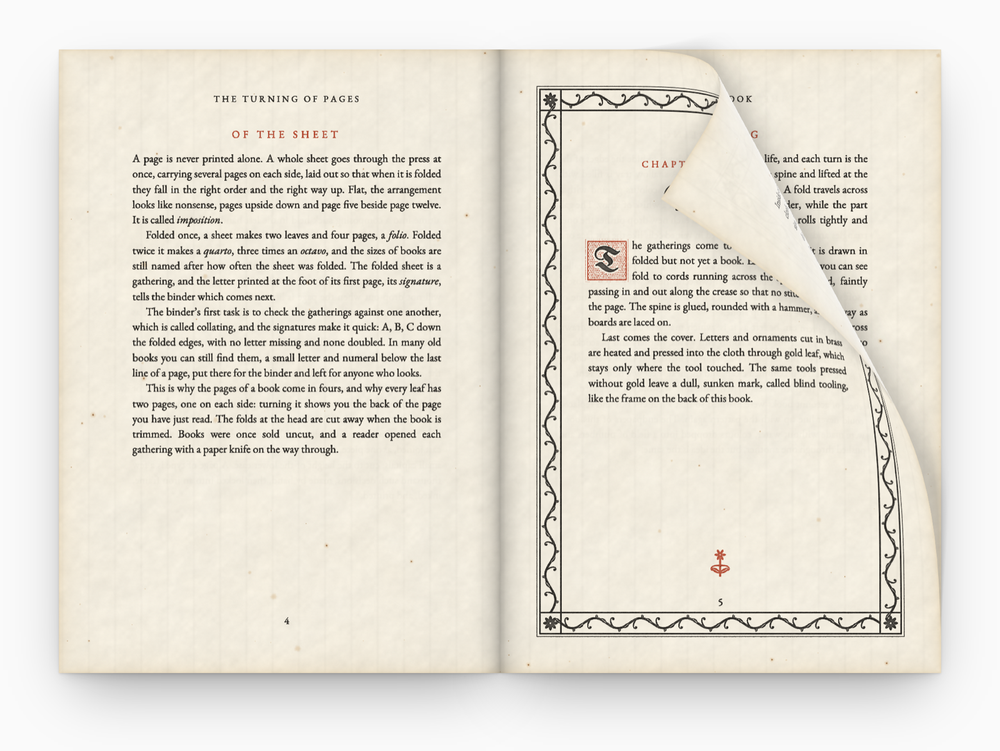

<div align="center">


# pagecurl

**A realistic page curl for any HTML.**

[](packages/react)
[](packages/react-native)
[](packages/core)
[](#how-it-works)
[](LICENSE)

[Live demo](https://pagecurl.co) · [Docs](https://pagecurl.co/#docs) · [React Native docs](https://pagecurl.co/react-native/#docs) · [Full-screen demo](https://pagecurl.co/play) · [Report an issue](https://github.com/deebov/pagecurl/issues)

</div>

<br>

<a href="https://pagecurl.co"></a>

## Features

- **A real curl.** The page wraps round a cylinder as it turns, with shading along the bend, a see-through back and a soft shadow on the page underneath.
- **Any HTML.** Every child of an element becomes a page. Pages stay live DOM while they lie flat, so links, inputs and text selection work as normal.
- **Every way to turn.** Drag a corner, tap near an edge, or turn from code. You can also drive a drag yourself from a slider, scroll position or any other input.
- **Single pages or spreads.** One page bound at the edge, or two side by side bound in the middle, reading left to right or right to left.
- **Pixel-exact when you need it.** Hand it your own canvases, like PDF pages, and the curl turns exactly what's on screen. `liveFlat` keeps text that isn't moving from shifting.
- **No dependencies.** About 22 kB gzipped, written in TypeScript and drawn with WebGL. The React package bundles the core and needs nothing but React.

## Install

```sh
npm install @pagecurl/react          # React
npm install @pagecurl/core           # plain JavaScript, or any other framework
npx expo install @pagecurl/react-native @shopify/react-native-skia   # React Native
```

| Package                                           |                                                                       |
| ------------------------------------------------- | --------------------------------------------------------------------- |
| [`@pagecurl/react`](packages/react)               | A `<PageCurl>` component and a `usePageCurl` hook.                    |
| [`@pagecurl/core`](packages/core)                 | Framework-agnostic. Hand it an element and its children become pages. |
| [`@pagecurl/react-native`](packages/react-native) | A `<PageCurl>` component for iOS and Android, drawn with Skia.        |

## Get started

**React.** Give the book a size, and each child is a page:

```tsx
import { PageCurl } from '@pagecurl/react';

export function Book() {
  return (
    <PageCurl style={{ width: 360, height: 500 }}>
      <Cover />
      <Chapter />
      <Notes />
    </PageCurl>
  );
}
```

**Plain JavaScript.** Every child of the element becomes a page:

```js
import { createPageCurl } from '@pagecurl/core';

const curl = createPageCurl(document.querySelector('#book'), {
  spread: true,
  onPageChange: (page) => console.log('now on page', page),
});

nextButton.onclick = () => curl.next();
```

**React Native.** The same component for iOS and Android, drawn with Skia. It runs in Expo Go:

```tsx
import { PageCurl } from '@pagecurl/react-native';

export function Book() {
  return (
    <PageCurl style={{ flex: 1 }}>
      <Cover />
      <Chapter />
      <Notes />
    </PageCurl>
  );
}
```

Every option, method and event is listed in the [core](packages/core/README.md), [React](packages/react/README.md) and [React Native](packages/react-native/README.md) READMEs, and on [pagecurl.co](https://pagecurl.co/#docs) ([React Native](https://pagecurl.co/react-native/#docs)).

<details>
<summary>Why does text shift a little when a page starts to turn?</summary>

<br>

Browsers can't take a picture of an element, so the turning page is copied and drawn again as an image, and its text can land a fraction of a pixel away from where it was. Turn on `liveFlat` so the part of the page that isn't bending stays live, size text in whole pixels, or pass pages that are already pixels as their own `snapshot`. The [FAQ](packages/core/README.md#faq) goes through each.

</details>

<details>
<summary>What can't be captured?</summary>

<br>

Cross-origin images and fonts without CORS headers, the contents of `<iframe>`s, and scrolled content inside a page, which is captured scrolled to the top. Without WebGL, pages still turn, just without the curl. See [how pages are captured](packages/core/README.md#how-pages-are-captured).

</details>

## Examples

- **[The demo book](site/book)** on [pagecurl.co](https://pagecurl.co): paper, ink, cloth, gilt and marbled endpapers all drawn procedurally in WebGL, with page-turn sounds synthesised in Web Audio.
- **[A PDF viewer](examples/pdf)**, in plain JavaScript with pdf.js, turning the pages' own canvases.
- **[A paginated novel](examples/novel)**, in React: _Alice’s Adventures in Wonderland_, flowed into pages that fit the screen.
- **[`liveFlat` compared](examples/compare)** with the default, side by side.
- **[A React Native book](examples/native)**, an Expo app that shows a two-page spread on wide screens like an open foldable. Run `bun run build`, then `npm install` and `npx expo start` in `examples/native`.

To run them from a clone of this repository, with [Bun](https://bun.sh):

```sh
bun install
bun run site       # the landing page, http://localhost:3001 (and /play)
bun run demo       # the feature demo, http://localhost:3000
bun run examples   # /pdf, /novel and /compare on http://localhost:3002
```

## How it works

- `geometry/drive.ts` maps a pointer position to three curl inputs: how far the curl has travelled (`time`), the cylinder `radius`, and the `angle` it travels in. It also gives the start and end values for animated turns.
- `geometry/mesh.ts` builds the triangles for those inputs: textured strips for both faces, anti-aliased fringes, the shadow on the page below and the rim shadow around the back. The arithmetic runs in float32 so every browser draws the same mesh.
- `renderer.ts` draws the mesh with WebGL in three modes: plain colour, texture, and colour masked by texture alpha.
- `snapshot.ts` turns a page into an image by cloning it with inlined styles and drawing it through an SVG `foreignObject`.
- `page-curl.ts` ties it together: page layout, gestures, the public API and the render loop.

<details>
<summary>Repository layout</summary>

<br>

```
packages/
  core/     src/, test/
  react/    src/
demo/       demo app (React book and a plain-JS postcard)
site/       landing page; site/book/ draws its demo book, site/play/ is the full-screen demo
examples/   pdf/ (plain JS, pdf.js), novel/ (React, pagination), compare/ (default vs liveFlat)
scripts/    build scripts
```

</details>

## Development

Using pagecurl needs nothing but npm, or any package manager. Working on this repository needs [Bun](https://bun.sh), which builds the packages and the site and runs the tests.

- `bun run build` builds the packages into `packages/*/dist`: ESM, CommonJS and type declarations.
- `bun test` runs the unit tests. The mesh and gesture tests compare against recorded output bit for bit.
- `bun run check` runs lint, the format check, types and tests together.
- `bun run format` formats everything with `bun fmt`, and `bun run lint` runs `bun lint`. Both are built into Bun and set up in `bunfig.toml`.
- `bun run demo:build` writes `demo/dist/index.html`, a single file you can open from disk.
- `bun run site:build` writes `site/dist`: the landing page and `/play`, prerendered.
- `bun run site:deploy` builds the site and publishes it to Cloudflare (`site/wrangler.jsonc`).

## Contributing

Issues and pull requests are welcome. For anything bigger than a small fix, please open an issue first so we can talk it through.

## License

pagecurl is available under the [MIT license](LICENSE).
